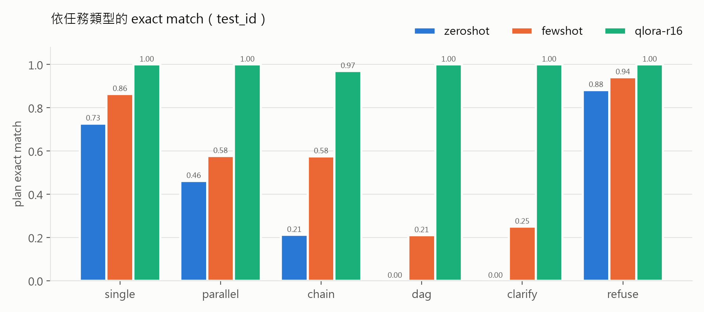
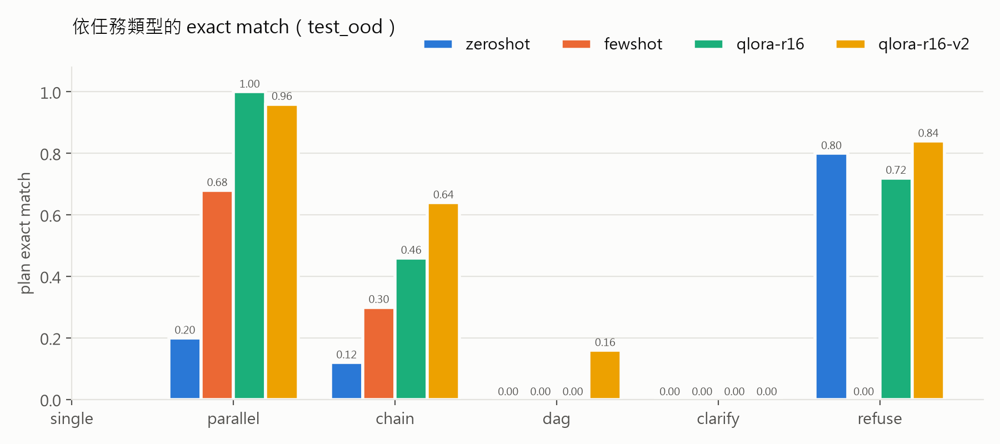
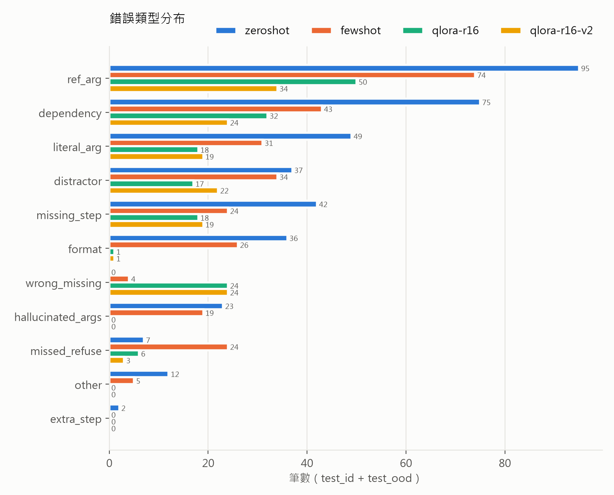

# Error Analysis

所有數字都來自 `reports/results.md`，是本批測試集的觀察值。exact match 附 95% bootstrap CI；CI 重疊的情況不宣稱有差異。訓練只跑一次，seed 固定為 42。

## 1. 整體結論

| run | test_id（n=121） | test_ood（n=149） |
|---|---|---|
| zero-shot | 0.413 [0.322, 0.504] | 0.208 [0.141, 0.275] |
| few-shot（3 shots） | 0.612 [0.521, 0.702] | 0.215 [0.148, 0.275] |
| **QLoRA r16** | **0.992 [0.975, 1.000]** | **0.443 [0.362, 0.517]** |

- 在 test_id 與 test_ood 上，QLoRA 的 CI 都與兩個 baseline 不重疊，可以說它比 baseline 好。
- few-shot 在 test_id 比 zero-shot 好，兩者的 CI 不重疊；但在 test_ood 上兩者完全重疊，**few-shot 對沒看過的結構幾乎沒有幫助**。
- 微調的進步**不只是學會輸出格式**：
  - 微調前輸出就都能解析成 JSON（1.000），schema 合法率也有 0.83–0.92，所以格式不是主要差距。
  - 真正拉開差距的是：引用參數準確率（OOD 從 0.433 升到 0.520）、相依關係準確率（0.590 升到 0.690）、action 準確率（0.638 升到 0.953）。
  - 因此判斷不需要另外做 constrained decoding ablation。

## 2. 泛化：test_id vs test_ood

| run | test_id − test_ood |
|---|---|
| zero-shot | 0.205 |
| few-shot | 0.397 |
| QLoRA | 0.549 |

- 差距隨模型變強而擴大，意思是**模型越會做訓練時看過的結構，在沒看過的結構上落差越大**。
- QLoRA 在 val 上的 exact match 是 1.000（n=167），val loss 降到 1.5e-5。這表示模型已經把訓練時看過的 24 個結構完全學會，所以 val 指標無法反映泛化能力，**OOD 才是唯一可信的泛化訊號**。
- 把 test_ood 拆成 6 個 holdout 結構來看（QLoRA，每個結構 n≈25）：

| 結構 | 類型 | exact | 這個結構需要什麼 |
|---|---|---|---|
| S10 | parallel | 1.00 | 舊的步驟重新組合 |
| S17 | chain | 0.92 | 舊的步驟重新組合 |
| S30 | refuse | 0.72 | 根據工具清單判斷做不到 |
| S16 | chain | 0.00（還原嵌入引用後 0.44） | 舊的步驟，新的串接方式 |
| S22 | dag | 0.00 | **新的參數組合**（draft_response 同時帶 arguments 與 amendments） |
| S26 | clarify | 0.00 | **新的輸出形狀**（一次缺兩個欄位） |

**核心發現：把訓練時看過的元件重新組合時，模型可以泛化（S10、S17），但不穩定（S16 元件全見過，只因串接方式與引用寫法不同就 0 分，見模式 C）；需要訓練資料裡從沒出現過的元件時（S22、S26），就完全失敗。** 第 4 節用訓練集的統計數字支持這一點。這些結論來自 6 個 holdout 結構，屬於觀察，不是普遍定律。

## 3. 依任務類型

- **進步最多的是 dag**（test_id 從 0.21 升到 1.00，n=19）**和 clarify**。clarify 在 action 混淆矩陣上，從 few-shot 判對 5/28 筆，升到 QLoRA 判對 28/28 筆。也就是說，模型已經學會「資訊不夠時要先問」。
- **最差的仍然是 OOD 的 dag（S22）與 clarify（S26），兩者都是 0.00**，原因見第 4 節。
- **refuse 有一個有教學價值的反例**：few-shot 讓 OOD 的 refuse 從 0.80 掉到 0.00（n=25），但 test_id 的 refuse 反而從 0.88 升到 0.94。3 個示範是 S18（plan）、S25（clarify）、S27（refuse），其中 refuse 示範是「完全沒有相關工具」；OOD 的 S30 則是「有部分相關工具、只缺 `calc_deadline`」，模型被帶向產出 plan。也就是說，示範教的是表面樣式，沒有教「逐一核對需要的工具是否都在清單裡」。QLoRA 把它拉回 0.72。
- clarify 在 test_id 只有 n=4，因為改寫後的句子與 train 重複，被去重剔除了（見資料段）。clarify 的結論要以 test_ood 的 n=24 為主。

## 4. 錯誤型態

- **微調前後的比較**：test_ood 的 `format` 錯誤從 26/15（zero-shot / few-shot）降到 1，`hallucinated_args` 從 19/16 降到 0。仍然偏高的是 `ref_arg`（49）、`dependency`（31）、`wrong_missing`（24）。
- 以下 3 個模式來自細讀 30 筆失敗案例（`reports/failures_qlora-r16.md`，每筆都有觀察）。它們全部來自 test_ood，集中在 S16、S22、S26。另外有 1 筆 S17 屬於模式 C。

### 模式 A：訓練資料沒出現過的參數組合，模型沒有產生（S22，25/25 失敗）

- **代表案例**：`test_ood-00098`。gold 是先取 OA、修正請求項，兩者再匯合到 `draft_response(arguments=$s1.grounds, amendments=$s2.amended_claim)`。模型修正了請求項，但 `draft_response` 只接一個來源，而且沒有 `amendments`。
- **證據**：
  - train 裡 `draft_response` 帶 `amendments` 的筆數是 **0/2039**。
  - QLoRA 在 S22 產出 `amendments` 的筆數也是 **0/25**。
  - 另有 15/25 筆直接漏掉 `get_office_action`，把字面文字（例如「核駁理由」）塞進 `arguments`。
- **解讀**：結果顯示模型主要依賴「每個工具在訓練資料裡實際用過的參數樣式」，沒有穩定依工具簽名泛化：即使工具清單已經寫明有 `amendments` 這個參數，模型也沒有用。這是假設而非定論，沒有做 tool schema ablation 或 unseen-tool 測試。

### 模式 B：clarify 的缺漏清單長度被訓練資料固定（S26，24/24 失敗）

- **代表案例**：`test_ood-00109`。「請求項1和引證案有什麼不同？」的 gold 是 `missing=[case_id, reference_patent_no]`，模型回答 `[claim_text, reference_patent_no]`。
- **證據**：
  - train 的 clarify 中，缺漏清單長度是 1 的占 **237/237**。
  - S26 的預測分布：9 筆只列 `[case_id]`（長度 1）；13 筆照抄 `compare_claims` 的參數名 `[claim_text, reference_patent_no]`，沒想到請求項文字要先用 `get_case` 取得；2 筆列 `[patent_no]`。
  - **標註歧義**：直接追問請求項文字（`[claim_text, reference_patent_no]`）語意上也說得通，但評分只接受一個 gold 集合。所以 S26 的 0 分有一部分可能來自標註設計，而不全是模型錯誤。
- **解讀**：action 判斷 28/28 全對，代表模型知道「該問」，但不知道「要問什麼」。這一題需要兩跳推理：先看出 `compare_claims` 需要 `claim_text`，再推出 `claim_text` 要由 `get_case(case_id)` 取得。訓練資料其實有一種兩跳：S23（73 筆）從 `calc_deadline` 需要的 `issue_date` 推到追問 `oa_id`；但只有這一個方向，模型沒有把它轉移到別的工具組合。

### 模式 C：引用的寫法不同，加上看到「客戶」就去查案件（S16、S17）

- **代表案例**：`test_ood-00029`。步驟、相依、引用都正確，但 `message` 寫成「…新期限為：$s2.deadline」，gold 要的是純引用 `$s2.deadline`。
- **敏感度分析**（`evaluation/sensitivity.py`）：把「字串裡恰好嵌入一個引用」的參數還原成純引用後，exact match 變化如下：
  - QLoRA 在 test_ood 從 0.443 升到 0.517，S16 從 0/25 升到 11/25。
  - 兩個 baseline 也同樣上升：zero-shot 從 0.208 升到 0.329，few-shot 從 0.215 升到 0.302。
  - 這代表**主指標中有一部分失敗，其實是違反了格式約定，而不是規劃錯誤**。主指標維持事先定好的嚴格版本、事後不改，以免被質疑為了分數調整指標；放寬版並列呈現。（Task 10 的 Executor 已能代入嵌在句子裡的引用，所以這類計畫實際上可以執行。）
- **另一個子模式**：S16 有 10/25 筆多加了一步 `get_case`，第一步就去查案件，導致後面的步驟編號全部位移。train 裡含「客戶」的 208 筆需求，沒有一筆用到 `get_case`，所以這不是從訓練資料學來的共現關係，**原因目前不確定**。

## 5. 限制與下一步

| 限制 | 影響 | 改善方式 |
|---|---|---|
| 只有 30 個模板，每個工具的參數樣式固定 | 與模式 A、B 相關：模型主要依賴樣式，沒有穩定依工具簽名泛化 | 依工具簽名系統性地產生參數組合，並讓 clarify 的缺漏長度涵蓋 1–3 |
| OOD 只有 6 個結構，每個 n≈25 | 單一結構的結論粒度很粗；CI 是對樣本做 bootstrap，不是對結構做 bootstrap | 增加 holdout 結構數，改成以結構為單位計算 CI |
| 只訓練一次（seed 42） | 無法區分不同 seed 之間的變異和真正的效果 | 用 3 個 seed 重訓，回報平均值與範圍 |
| test_id 的 clarify 只有 n=4 | 這一格的結論不可靠 | 讓 clarify 的句型更多樣，避免去重後被剔除 |
| 改寫模型引入錯字（「答辨」51 筆、「答辦」3 筆，約 2.1%） | 視為真實使用者的錯字雜訊，沒有修正 | 在改寫檢查中加入領域詞白名單 |
| 守門只保護 slot，slot 以外的用字不受檢查：混入無意義英文 23 筆（0.9%）、把專利號稱為「案號」59 筆（2.4%）；人工標記 90 筆中 ❌ 6 筆（`reports/spot_check.md`） | gold 不受影響，但句子自然度下降；專利號被叫成案號，可能讓模型混淆 `case_id` 與 `patent_no` | 守門加入「不得新增原句沒有的拉丁字母詞」與術語白名單；改寫後用另一個模型做語意等價判定 |
| 主指標要求純引用 | 會把格式問題算成規劃錯誤（見模式 C） | 在 prompt 明確要求「引用不得嵌入句子」；或事先改定以 Executor 能否代入為準的指標 |
| clarify 只接受一個 gold 集合 | S26 有語意上也合理的答案被判錯 | 為 clarify 定義可接受的多個缺漏集合 |
| 改寫檢查的編號規則只認得合成格式（如 `I` 開頭的專利號、`OA-` 編號） | 改寫若捏造其他格式的號碼（如「第 701234 號」）擋不到 | 擴充編號規則，或改為檢查所有數字串 |

## 6. 第二輪：針對性補資料（qlora-r16-v2）

設計見 `docs/plan-v2.md`。這一輪只補第 4 節找到的元件缺口：新增模板 S31–S35，在 v1 train 之外加入 495 筆，總數 2534 筆。val、test、超參數與 prompt 都不變。**所有 holdout 結構都沒有放進訓練資料。**

### 整體

| run | test_id（n=121） | test_ood（n=149） |
|---|---|---|
| qlora-r16（v1） | 0.992 [0.975, 1.000] | 0.443 [0.362, 0.517] |
| qlora-r16-v2 | 1.000 [1.000, 1.000] | 0.544 [0.463, 0.617] |

- 兩組在 test_ood 上各自的 CI 有重疊（0.463–0.517）。但兩組考的是**同一批題目**，應該改用**配對 bootstrap**（`evaluation.sensitivity --paired`），檢定力比較高。結果是 test_ood **+0.101 [+0.040, +0.161]**，CI 不含 0。test_id 是 +0.008 [+0.000, +0.025]，**補資料沒有傷害模型原本學會的結構**。
- 作為對照，用同樣方法算 v1 − few-shot：test_ood +0.228 [+0.161, +0.295]。

### 依 holdout 結構（exact 筆數，每個結構 n≈25）

| 結構 | v1 | v2 | 解讀 |
|---|---|---|---|
| S22 dag | 0 | 4 | **元件學會了，組合還沒有**：帶 `amendments` 的預測從 0/25 增加到 16/25；但仍有 16/25 漏掉 `get_office_action`，只有 9/25 用到 `.grounds` |
| S16 chain | 0 | 7 | 多做 `get_case` 從 10 筆降到 5 筆；還原嵌入引用後是 18/25（v1 為 11/25） |
| S30 refuse | 18 | 21 | 小幅改善 |
| S17 chain | 23 | 25 | — |
| S10 parallel | 25 | 24 | 持平 |
| **S26 clarify** | **0** | **0** | **完全沒有改善**，見下方說明 |

### 第 4 節的假設，哪些成立

- **模式 A（沒見過的參數組合）部分成立**：
  - 補上 `amendments` 後，模型確實開始使用這個參數，從 0 增加到 16/25。支持「訓練資料沒出現過的參數，模型就不會產生」這個診斷。
  - 但 S22 還需要「`.grounds` 當論點」加上「`amendments`」，再匯合到同一個 `draft_response`。這兩個元件分別出現在 S31 與 S32/S33，模型**沒有把兩個分開學到的元件組合起來**，exact 只有 4/25。
- **模式 B（clarify 的缺漏清單）不成立**：
  - S34 與 S35 教了「缺 2 項」，S35 再加一個兩跳例子（方向與 S23 相同），但 S26 仍然是 0/24。
  - 預測不再固定只列 1 項，但分布很散：`[case_id]` 7 筆、`[reference_patent_no]` 7 筆、`[patent_no]` 5 筆、`[claim_text, reference_patent_no]` 5 筆。
  - 解讀：模型學到的是「這個句型要問哪幾個欄位」，而不是「從工具簽名推出缺什麼」。S26 的兩跳方向（從 `compare_claims` 的參數推到 `get_case`）和 S35（從 `calc_deadline` 推到 `get_office_action`）不同，**這種推理沒有轉移到別的工具組合**。

### 結論

**補元件確實有效（OOD +0.10；在這批題目上配對 CI 不含 0，但這只涵蓋抽題變異，沒有涵蓋訓練 seed 的變異），但效果止於元件本身。** 只要題目需要把元件組合起來，或需要依工具簽名推理，進步就很有限。副作用：OOD 誤用干擾工具的比例從 0.17 升到 0.22（plan-v2 風險段已預期：答辯書類資料變多，模型更傾向多做步驟）。這支持第 5 節的方向：要讓模型泛化，訓練資料應該依工具簽名系統性地涵蓋各種組合，而不是逐一補洞。另外，S22 與 S26 的 OOD 性質在 v2 已經變弱，因為這一輪是依它們的失敗原因去補資料，所以 v2 的 OOD 數字應該視為**比 v1 樂觀的估計**。
